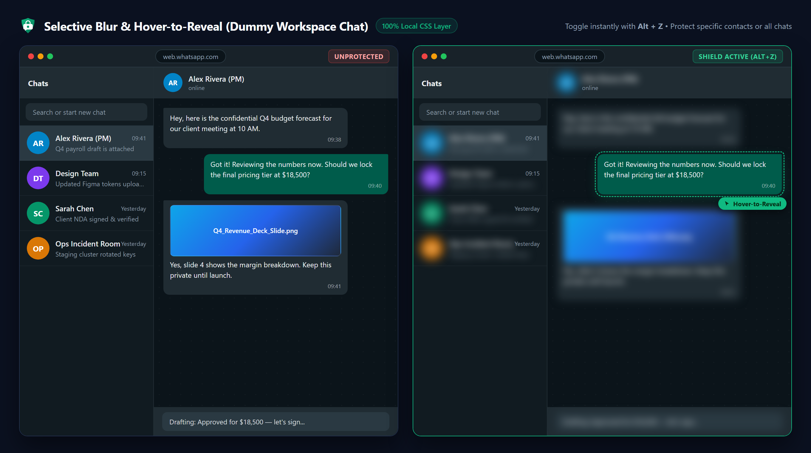
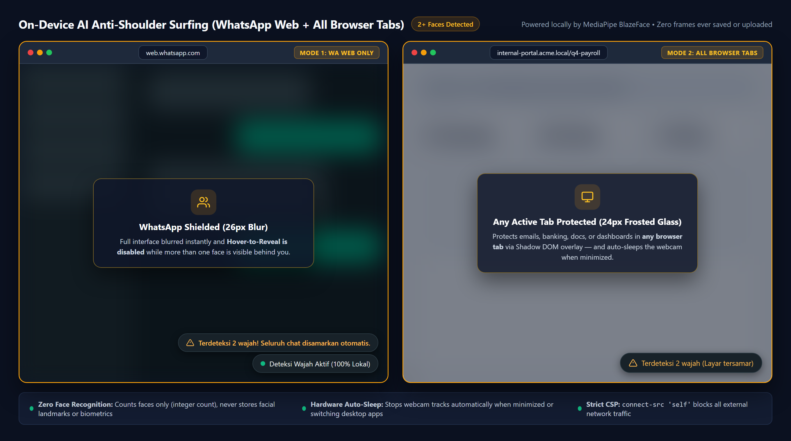
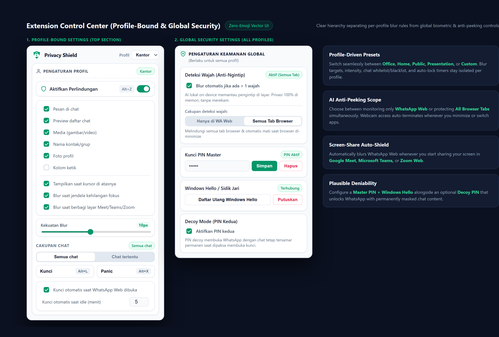
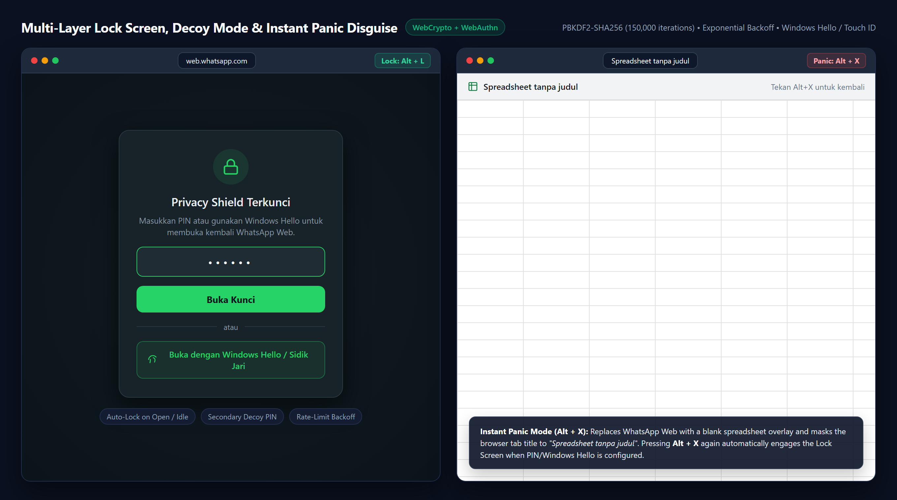

<div align="center">
  
  <h1>Privacy Shield for WA Web</h1>
  <p><strong>100% Local-First Privacy Armor for WhatsApp Web &amp; Browser Tabs</strong></p>
  <p>
    Manifest V3 Extension for <strong>Chrome</strong>, <strong>Edge</strong>, and <strong>Firefox</strong> &bull;
    Zero Cloud Requests &bull; On-Device AI Anti-Peeking &bull; Biometric Lock &amp; Decoy Mode
  </p>
  <p>
    <a href="#-installation-guide">Installation</a> &bull;
    <a href="#-key-features">Features</a> &bull;
    <a href="#-why-privacy-shield-comparison">Comparison</a> &bull;
    <a href="#-facial-data--camera-security">Camera Security</a> &bull;
    <a href="PRIVACY.md">Privacy Policy</a>
  </p>
</div>

---

## What is Privacy Shield for WA Web?

**Privacy Shield for WA Web** is an open-source, **100% local-first** browser extension designed to protect sensitive conversations, media, and browser tabs from prying eyes (*shoulder surfing*), unexpected passersby in public or office spaces, and accidental leaks during screen sharing.

Unlike generic blur extensions that rely on remote scripts or simple all-or-nothing CSS toggles, **Privacy Shield** combines:
- Granular **per-profile selective blur** and **specific-chat scoping**
- Real-time **on-device AI anti-shoulder surfing** (for **both** WhatsApp Web and **all other browser tabs**) with **automatic webcam hardware sleep**
- Multi-layer **cryptographic PIN + Windows Hello / Touch ID + Decoy PIN** lock screens
- Instant **Screen-Share Auto-Shield** (Google Meet, Microsoft Teams, Zoom Web) and **Panic Mode**

> **Transparency Note:** Visual blurs, lock screens, and decoy modes act as a **visual display layer** (not disk/E2EE encryption). Strict network isolation is enforced via Content Security Policy (`connect-src 'self'`). See [PRIVACY.md](PRIVACY.md).

---

## Visual Showcase (Dummy Workspace Demos)

> *All screenshots below use synthetic dummy chats and mock dashboards — no real user messages or personal data are exposed.*

### 1. Selective Blur & Hover-to-Reveal
Mask messages, chat list previews, media thumbnails, contact/group names, profile pictures, and the compose bar independently (`2px`–`20px`). Point your cursor at any item to temporarily read it with **Hover-to-Reveal**.



### 2. On-Device AI Anti-Shoulder Surfing (WhatsApp Web & All Browser Tabs)
Detect when someone looks over your shoulder (`> 1 face` in view) using **bundled MediaPipe BlazeFace AI** running locally in memory. Choose between shielding **only WhatsApp Web** or **every active tab in your browser** (emails, banking, internal dashboards) with a frosted-glass overlay.



### 3. Control Center (Profile-Bound & Global Security Hierarchy)
Clean zero-emoji vector interface separating **Profile-Bound Settings** (*Office, Home, Public, Presentation, Custom*) from **Global Security Controls** (*AI Anti-Peeking, Master PIN, Windows Hello, Decoy Mode*).



### 4. Multi-Layer Lock Screen, Decoy Mode & Instant Panic (`Alt + X`)
Lock WhatsApp Web manually (`Alt + L`), on tab load, or after idle timeout. Unlock with a PBKDF2-hashed Master PIN, **Windows Hello / Touch ID**, or enter a **Decoy PIN** under coercion to reveal WhatsApp with chats permanently masked. Press **`Alt + X`** anytime to replace WhatsApp Web with a blank spreadsheet disguise.



---

## Key Features

### Privacy Masking & Profiles
- **Selective Element Blur:** Independently toggle blur for chat messages, chat list previews, media (images/videos/canvas), contact & group names, profile avatars, and the compose input box.
- **Hover-to-Reveal & Presentation Mode:** Peek at individual blurred messages on mouse hover, or lock **Presentation Mode** so names and avatars remain blurred even when hovered.
- **5 Smart Profiles:** Save distinct rulesets, blur intensities, chat scopes, and auto-lock settings per scenario (`Kustom`, `Kantor`, `Rumah`, `Tempat umum`, `Presentasi`).
- **Flexible Chat Scope:** Blur *all* chats or select **specific contacts/groups** using a chip selector synced live from your WhatsApp Web sidebar.

### Intelligent Automation & Shortcuts
- **Screen-Share Auto-Blur:** Automatically hides WhatsApp Web whenever you start sharing your screen on **Google Meet**, **Microsoft Teams**, or **Zoom Web**.
- **Blur on Window Focus Loss:** Blurs WhatsApp Web automatically when switching to another desktop window.
- **Instant Keyboard Shortcuts:**
  - `Alt + Z` — Toggle blur protection on/off
  - `Alt + L` — Lock WhatsApp Web immediately
  - `Alt + X` — **Panic Mode**: switch instantaneously to a neutral blank spreadsheet overlay (`"Spreadsheet tanpa judul"`) and mask the tab title; pressing `Alt + X` again engages the lock screen if authentication is enabled.

### Multi-Layer Access Control
- **Master PIN (PBKDF2-SHA256):** Locally hashed via WebCrypto (`150,000` iterations + `16-byte` random salt) with rate-limiting exponential backoff (`up to 5 minutes` after repeated failures).
- **Windows Hello / Touch ID (WebAuthn):** Fast hardware-backed biometric unlock bound to WhatsApp Web.
- **Decoy Mode (Secondary PIN):** Optional alternate PIN that unlocks the lock overlay while keeping all chats and sidebars permanently blurred (`14px`) without hover-reveal.
- **Auto-Lock:** Automatically lock WhatsApp Web on initial page load or after `N` minutes of inactivity.

---

## Why Privacy Shield? (Comparison vs. Typical Extensions)

| Capability | Privacy Shield for WA Web | Typical WA Blur Extensions |
|---|---|---|
| **Architecture & Telemetry** | **100% Local-First**, open-source, CSP `connect-src 'self'` (zero outbound traffic) | Often closed-source, use remote CDNs, or bundle analytics/ad trackers |
| **AI Anti-Shoulder Surfing** | **Yes** — On-device MediaPipe BlazeFace detects `> 1` face automatically | Rarely supported; usually cloud-less manual blur only |
| **All-Tabs Browser Protection** | **Yes** — Protect **any active tab** (Gmail, Slack, banking, docs) under All-Tabs mode | Limited strictly to `web.whatsapp.com` |
| **Smart Camera Auto-Sleep** | **Yes** — Immediately stops hardware webcam (`track.stop()`) on tab switch, minimize, or app switch | No camera support, or keeps webcam running continuously when minimized |
| **Biometric & Decoy Security** | **Master PIN (PBKDF2 150k) + Windows Hello + Secondary Decoy PIN** | No lock screen, or weak plaintext PIN in localStorage |
| **Screen-Share Detection** | **Native hooks** for Google Meet, Microsoft Teams & Zoom Web | Manual toggle before presenting |
| **Profile & Per-Chat Rules** | **5 customizable profiles** + specific contact/group whitelist/blacklist | Single global setting |

---

## Facial Data & Camera Security

Privacy Shield treats biometric and visual privacy with zero compromise:

1. **Strict Opt-In Only:** Camera access is disabled by default and never requested until you explicitly enable **Deteksi Wajah (Anti-Ngintip)** and grant permission via the dedicated `camera-setup.html` prompt.
2. **Face Counting Only — Zero Facial Recognition:**
   - The extension bundles Google's **MediaPipe Tasks Vision** (`vision_bundle.mjs`, `blaze_face_short_range.tflite`, and local WASM in `src/vendor/`).
   - It captures low-resolution (`320x240`, `audio: false`) volatile `ImageBitmap` frames every `350ms` in memory, counts the integer number of faces (`detections.length >= 2`), and **immediately disposes of the frame** (`bitmap.close()`).
   - **No facial landmarks, face IDs, photos, or video streams are ever stored, recorded, or transmitted.**
3. **Hard Network Isolation (`connect-src 'self'`):**
   - Browser-enforced CSP rules in `manifest.json` physically prevent any extension page or offscreen worker from opening external network sockets or uploading frames.
4. **Hardware Webcam Auto-Sleep (LED Off Guarantee):**
   - **WA Web Only Mode:** Webcam tracks are actively stopped (`track.stop()`) the moment you switch away from the WhatsApp Web tab, minimize the browser, or switch to another desktop application.
   - **All Browser Tabs Mode:** Webcam monitors whichever tab you are browsing inside the browser, and **automatically turns off the camera hardware** within milliseconds whenever you minimize the browser or switch focus to another desktop app (verified across multi-layer window focus, bounds/minimize, and tab visibility listeners).

---

## Installation Guide

You can install directly using the pre-built packages included in `dist/`, or build from `src/`.

### Step 1: Get the Repository
Clone the repository (or click **Code → Download ZIP** on GitHub and extract it):
```bash
git clone https://github.com/hielmymuthohar/waprivasy.git
```

### Step 2: Load into Your Browser

#### Google Chrome / Microsoft Edge / Brave
1. Open `chrome://extensions` (or `edge://extensions` for Edge).
2. Enable **Developer mode** (top-right toggle).
3. Click **Load unpacked**.
4. Select the **`dist/chrome`** folder inside the cloned/extracted repository.
5. Pin **Privacy Shield for WA Web** to your browser toolbar.

#### Mozilla Firefox
1. Open `about:debugging#/runtime/this-firefox`.
2. Click **Load Temporary Add-on...**.
3. Select the **`dist/firefox/manifest.json`** file inside the repository.

*(Pre-packaged store archives are also available at `dist/privacy-shield-chrome.zip` and `dist/privacy-shield-firefox.zip`.)*

### Optional: Rebuild from Source (`src/`)
If you modify anything in `src/`, rebuild both targets and zip archives on Windows PowerShell:
```powershell
powershell -ExecutionPolicy Bypass -File build.ps1
```

### Enabling AI Anti-Peeking Camera Access
1. Open the **Privacy Shield** popup from the toolbar.
2. Scroll to **Pengaturan Keamanan Global → Deteksi Wajah (Anti-Ngintip)**.
3. Check **Blur otomatis jika ada > 1 wajah**.
4. A clean local setup tab (`camera-setup.html`) will open once to request browser camera permission — click **Allow**.
5. Choose your scope: **Hanya di WA Web** or **Semua Tab Browser**.

---

## Maintenance & Third-Party Notices

- **WhatsApp DOM Selectors:** WhatsApp Web occasionally updates its class names and attributes. All selectors are centralized in `src/content.css` and `src/content.js` for straightforward updates.
- **Third-Party Libraries:** On-device face detection uses [MediaPipe Tasks Vision](https://github.com/google-ai-edge/mediapipe) (`BlazeFace Short Range`, licensed under Apache-2.0), bundled offline inside `src/vendor/`.
- **Affiliation:** Independent open-source project; not affiliated with WhatsApp or Meta Platforms, Inc.
